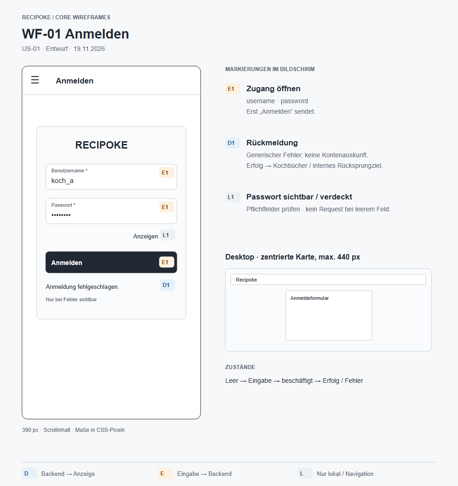
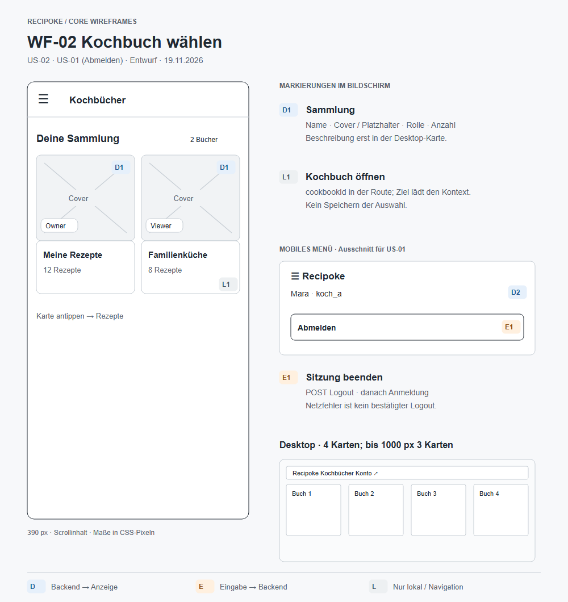
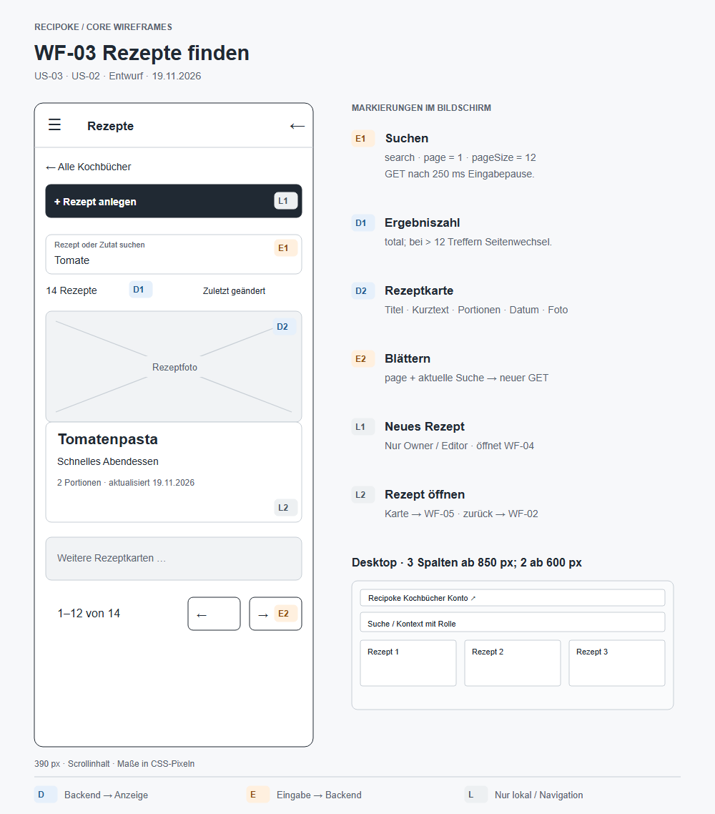
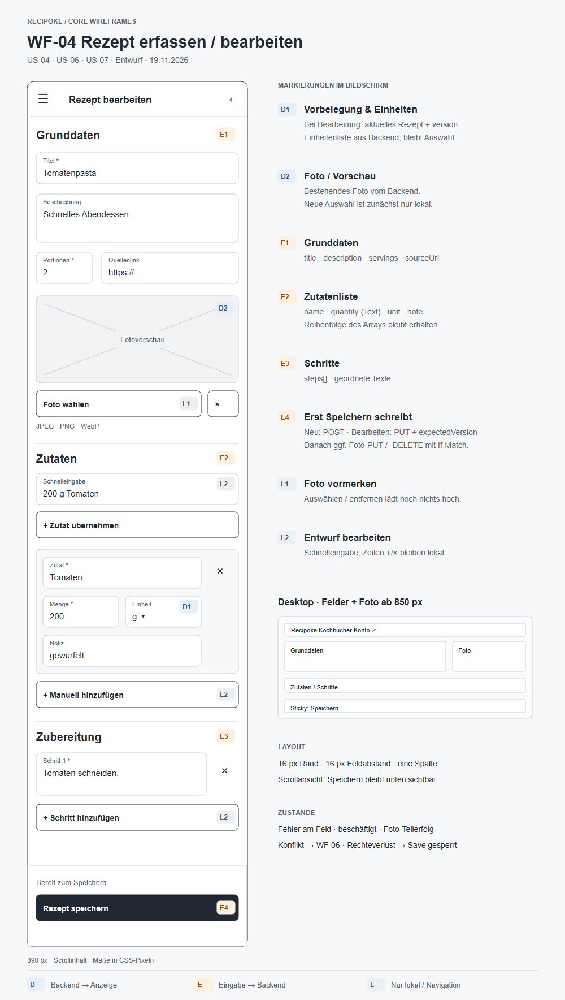
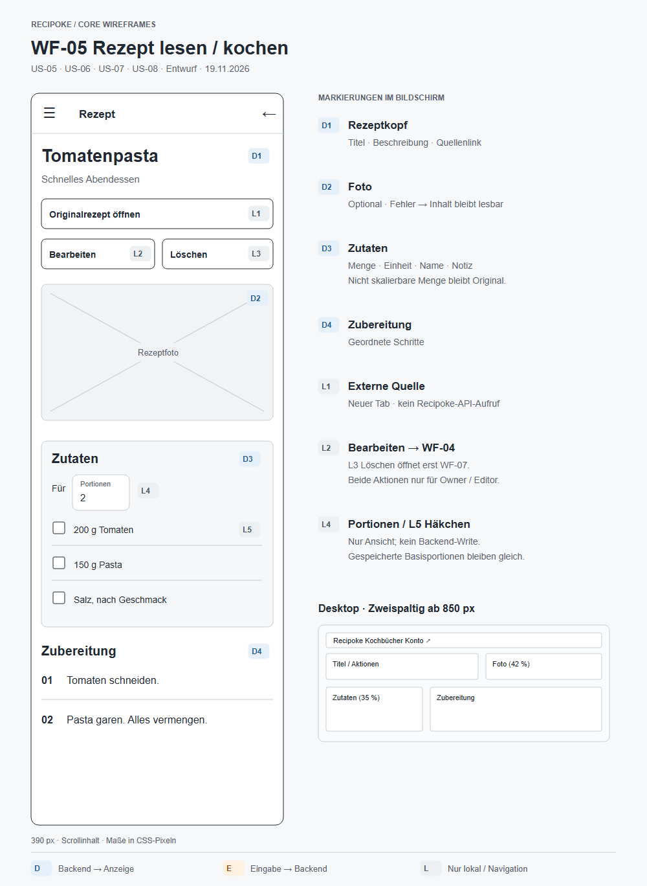
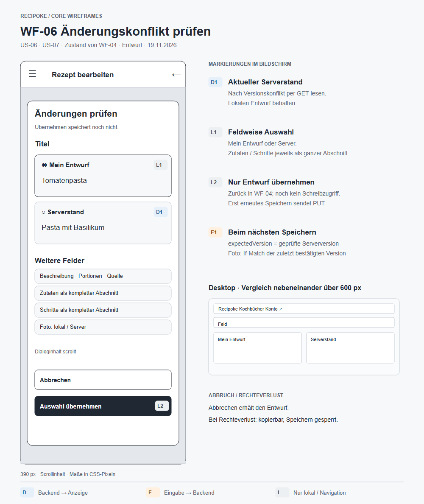
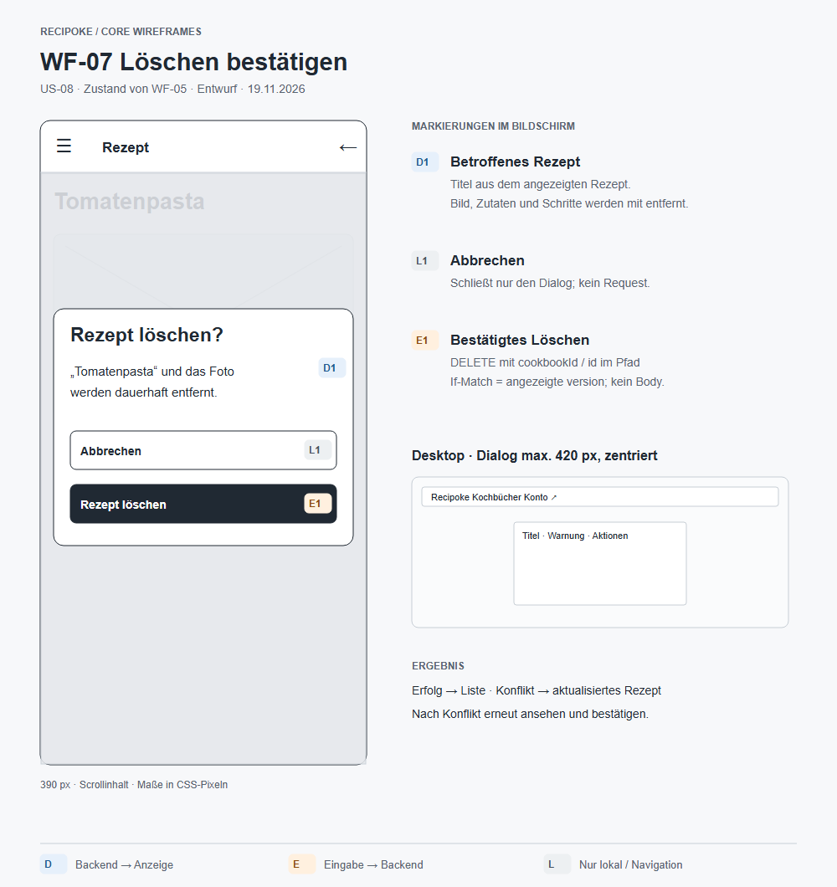

# Wireframes

Stand: 19.11.2026. **Entwurf zur Prüfung, noch nicht gemergt.** Fünf Hauptansichten und zwei ergänzende Dialogzustände decken US-01 bis US-08 ab. Grundlage ist das aktuelle lokale Angular-Frontend einschließlich der vorhandenen, noch nicht veröffentlichten Änderungen.

**D** = Backend-Daten in der Anzeige · **E** = Eingabe/Auftrag an das Backend (auch GET-Parameter) · **L** = nur lokal oder Navigation. Die Nummern gelten jeweils innerhalb eines Bildes. `*` kennzeichnet Pflichtfelder; Mengen sind bei `toTaste` leer zulässig.

Mobil: 390 px Inhaltsbreite, eine scrollbare Ansicht; Kochbücher in zwei Spalten. Die kleinen Desktop-Schemata zeigen die alternative Aufteilung. Beschriftungen sind bewusst auf Deutsch gekürzt. Synthetische Beispieldaten und Bildplatzhalter; keine echten Nutzerdaten. Die Bilder sind Layout-Entwürfe, keine Screenshots oder neue Frontend-Implementierung.

## WF-01 – Anmelden

**Story:** [US-01](https://gitlab.ai.it.hs-worms.de/inf4155/Recipoke/-/work_items/9). Route: `/login`.

| Marker | Anzeige / Übertragung |
|---|---|
| D1 | Generischer Serverfehler; nach Erfolg bestätigt `GET /api/auth/me` die Sitzung. Die Identität erscheint erst im geschützten Bereich. |
| E1 | Anmelden → `POST /api/auth/login` mit `{username, password}`. Leere Pflichtfelder senden nichts. |
| L1 | Passwort anzeigen/verbergen. Erfolg führt zur Kochbuchauswahl oder zum erlaubten internen Rücksprungziel. |

Desktop: zentriertes Formular, maximal 440 px. Anmeldung ohne Registrierung oder Passwortreset. Beschäftigt: Submit gesperrt; Fehler bleibt am Formular.

## WF-02 – Kochbuch wählen

**Stories:** [US-02](https://gitlab.ai.it.hs-worms.de/inf4155/Recipoke/-/work_items/10), [US-01](https://gitlab.ai.it.hs-worms.de/inf4155/Recipoke/-/work_items/9) für Abmelden im Menü. Route: `/cookbooks`.

| Marker | Anzeige / Übertragung |
|---|---|
| D1 | `GET /api/cookbooks`: `id`, `name`, `role`, `recipeCount`, `imageUrl`; `description` nur in der Desktop-Karte. Cover optional über `/api/cookbooks/{cookbookId}/image`. |
| D2 | `GET /api/auth/me`: `displayName`, `username` im mobilen Menü. |
| E1 | Abmelden → `POST /api/auth/logout` mit `{}`. Netzfehler nicht als bestätigtes Sitzungsende ausgeben. |
| L1 | Karte öffnet `/cookbooks/{cookbookId}/recipes`; Zielguard liest `GET /api/cookbooks/{cookbookId}`. Kein Auswahl-Write. |

Desktop: vier Karten, bis 1000 px drei; mobil unter 600 px zwei. Fehlendes Bild → Platzhalter. Leere Sammlung und Ladefehler getrennt; letzterer mit „Erneut laden“. Erstellen, Einladungen und Mitgliedermenüs sind vorhandene Erweiterungen außerhalb dieses Core-Ausschnitts.

## WF-03 – Rezepte finden

**Stories:** [US-03](https://gitlab.ai.it.hs-worms.de/inf4155/Recipoke/-/work_items/11), Kontext und Rechte aus [US-02](https://gitlab.ai.it.hs-worms.de/inf4155/Recipoke/-/work_items/10). Route: `/cookbooks/:cookbookId/recipes`.

| Marker | Anzeige / Übertragung |
|---|---|
| D1/D2 | `GET /api/cookbooks/{cookbookId}/recipes`: `total`, `items[].id/title/description/servings/imageUrl/updatedAtUtc`. Bilder optional über den Bildendpunkt. Kontextname/Rolle in der Desktop-Überschrift aus dem Kochbuch-GET. |
| E1/E2 | Derselbe GET mit `search`, `page`, `pageSize=12`. Suche nach 250 ms Pause, neue Suche setzt Seite 1. Blättern sendet neue Seite plus aktuelle Suche; nur bei mehr als zwölf Treffern. |
| L1/L2 | „Anlegen“ → WF-04, Karte → WF-05; kein Write. Viewer sehen keine Anlegen-Aktion. |

Mobil eine Karten-Spalte, ab 600 px zwei, ab 850 px drei. Leerer Bestand, keine Suchtreffer und Ladefehler erhalten jeweils passende Rückmeldungen; Suche leeren bzw. erneuter GET sind möglich.

## WF-04 – Rezept erfassen oder bearbeiten

**Stories:** [US-04](https://gitlab.ai.it.hs-worms.de/inf4155/Recipoke/-/work_items/12), [US-06](https://gitlab.ai.it.hs-worms.de/inf4155/Recipoke/-/work_items/14), [US-07](https://gitlab.ai.it.hs-worms.de/inf4155/Recipoke/-/work_items/15). Routen: `/cookbooks/:cookbookId/recipes/new` und `/cookbooks/:cookbookId/recipes/:id/edit`.

| Marker | Anzeige / Übertragung |
|---|---|
| D1/D2 | `GET /api/units` liefert `code/label/milliliters`. Bei Bearbeitung: Rezept-GET inklusive `version` und bestehendes Foto. Der gleiche Editor ist bei Neuanlage zunächst leer. |
| E1–E3 | `title`, `description`, `servings`, `sourceUrl`, `ingredients[{name,quantity,unit,note}]`, `steps[]`. Mengen sind Strings; Zutaten/Schritte behalten ihre Reihenfolge. |
| E4 | Speichern: `POST /api/cookbooks/{cookbookId}/recipes` für Neuanlage, sonst `PUT /api/cookbooks/{cookbookId}/recipes/{id}` mit zusätzlichem `expectedVersion`. |
| E4 + L1 | Erst nach erfolgreichem Textsave: ggf. `PUT /api/cookbooks/{cookbookId}/recipes/{id}/image` mit rohen Bildbytes und `Content-Type`, oder `DELETE` auf denselben Bildpfad. Beide mit `If-Match` der zuletzt bestätigten Version. |
| L1/L2 | Fotoauswahl, Größenanpassung, Entfernen vormerken, Zutaten-Schnelleingabe und Zeilenbearbeitung bleiben bis Save lokal. Kein Upload allein durch Dateiauswahl. |

Mobil: Felder untereinander, Portionen/Quelle nebeneinander; Speichern bleibt am unteren Viewportrand sichtbar. Die lange Zeichnung entfaltet den Scrollinhalt. Ab 850 px: Grunddaten plus 260-px-Fotospalte; Formular maximal 1040 px. Import-Einstieg ist als EPIC-01 ausgeblendet. Bei ungültigen Feldern ist Save gesperrt; bei Fehlern bleibt der Entwurf erhalten. Textteilerfolg mit Fotofehler erzeugt beim Retry kein zweites Rezept. Konflikt → WF-06; Rechteverlust → Entwurf kopierbar, Save gesperrt.

## WF-05 – Rezept lesen und kochen

**Stories:** [US-05](https://gitlab.ai.it.hs-worms.de/inf4155/Recipoke/-/work_items/13), Fotoanzeige [US-07](https://gitlab.ai.it.hs-worms.de/inf4155/Recipoke/-/work_items/15); Einstiege für [US-06](https://gitlab.ai.it.hs-worms.de/inf4155/Recipoke/-/work_items/14) und [US-08](https://gitlab.ai.it.hs-worms.de/inf4155/Recipoke/-/work_items/16). Route: `/cookbooks/:cookbookId/recipes/:id`.

| Marker | Anzeige / Übertragung |
|---|---|
| D1–D4 | `GET /api/cookbooks/{cookbookId}/recipes/{id}`: `title`, `description`, `sourceUrl`, Basis-`servings`, `ingredients`, `steps`, `imageUrl`; `id/version` bleiben Aktionskontext. Optional Foto-GET auf `/image`. |
| L1–L3 | Quelle öffnet externen Tab. Bearbeiten navigiert zu WF-04; Löschen öffnet WF-07. Beide Schreib-Einstiege nur für Owner/Editor. Noch kein Write. |
| L4/L5 | Zielportionen 1–1000 und Zutatenhäkchen sind lokal. Mengen skalieren nur in der Ansicht; nicht skalierbare Mengen behalten den Originalwert. Keine Backend-Eingabe durch Kochen. |

Mobil: Kopf, optionale Quelle, Aktionen, optionales Foto, Zutaten, Schritte. Ab 850 px Kopf/Foto (42 %) und darunter Zutaten (35 %)/Schritte nebeneinander. Defektes Foto blockiert das Rezept nicht; ein nicht verfügbares Rezept zeigt Retry/Zugang.

## WF-06 – Änderungskonflikt prüfen

**Stories:** [US-06](https://gitlab.ai.it.hs-worms.de/inf4155/Recipoke/-/work_items/14), [US-07](https://gitlab.ai.it.hs-worms.de/inf4155/Recipoke/-/work_items/15). Dialogzustand von WF-04, keine eigene Route.

| Marker | Anzeige / Übertragung |
|---|---|
| D1 | Nach Versionskonflikt aktuelles Rezept per GET laden: Felder, Zutaten, Schritte, Foto und `version`. Lokaler Entwurf bleibt erhalten. |
| L1/L2 | Auswahl lokal/Server je Feld; Zutaten und Schritte jeweils als vollständiger geordneter Abschnitt. Übernehmen ändert nur den Entwurf; Abbrechen erhält ihn ebenfalls. |
| E1 | Kein Write im Dialog. Erst erneutes Speichern in WF-04 sendet die Auswahl mit geprüfter `expectedVersion`; anschließende Fotoaktion nutzt `If-Match`. |

Mobil bis 600 px Vergleich untereinander; darüber nebeneinander. Nur der Titelvergleich ist vollständig gezeichnet, die übrigen Vergleiche sind platzsparende Platzhalter für denselben Aufbau, keine neue Accordion-Funktion. Dialoginhalt scrollt. Ohne Berechtigung bleibt der lokale Entwurf kopierbar, Speichern ist gesperrt.

## WF-07 – Löschen bestätigen

**Story:** [US-08](https://gitlab.ai.it.hs-worms.de/inf4155/Recipoke/-/work_items/16). Dialogzustand von WF-05, keine eigene Route.

| Marker | Anzeige / Übertragung |
|---|---|
| D1 | Rezepttitel aus dem geladenen Stand; Hinweis auf dauerhafte Entfernung einschließlich Foto, Zutaten und Schritten. |
| E1 | Erst bestätigen: `DELETE /api/cookbooks/{cookbookId}/recipes/{id}`; `If-Match` aus angezeigter `version`, kein Body. |
| L1 | Öffnen/Abbrechen senden nichts. Erfolg → Liste. Versionskonflikt → Rezept erneut laden und vor einem weiteren Versuch erneut bestätigen. |

Dialog: Viewport minus 32 px, maximal 420 px breit; zentrale Warnung, getrennte Abbruch-/Löschaktionen. 401/403/404 sperren weitere Mutationen; andere Fehler bleiben sichtbar.

## Entwurfsvorschläge

Die bestehenden Vorschläge bleiben offen und sind **nicht als bereits vorhandene Funktionen eingezeichnet**:

| ID | Noch offene Ergänzung |
|---|---|
| UX-01 | Permanenter verständlicher Rollenhinweis auch in der mobilen Rezeptliste. |
| UX-02 | Feldnahe Fehlermeldung für ungültige Zielportionen und Hinweis „nur Anzeige“. |
| UX-03 | Getrennt sichtbare Text-/Foto-Speicherphasen und dauerhafter Teilerfolgsstatus. |

## Quellen und Bearbeitung

Basis: lokales `RecipeAtlasFrontend`, HEAD `20e3b64`, zusätzlich bestehende Arbeitskopie-Änderungen vom 19.11.2026. Gelesen wurden die HTML-/SCSS-Dateien der fünf Seiten (`login`, `cookbook-overview`, `recipe-list`, `recipe-editor`, `recipe-detail`), `app.component.html`, `ingredient-editor`, `photo-picker`, `conflict-review`, `recipe-conflict-review.ts`, `recipe-api.service.ts`, `auth.service.ts` und `recipe.model.ts`. Vorhandene mobile Screenshots dienten dem Layoutabgleich; sie wurden nicht als neue Laufzeitprüfung ausgegeben.

Die SVGs neben den PNGs sind die editierbaren Originale. Keine externen Fonts, Bilder oder Skripte sind eingebettet. PNGs wurden mit installiertem Chrome aus den SVGs gerendert und visuell geprüft. Die Abbildungen konzentrieren sich auf den Core: Kontoverwaltung, Einladungen, Kochbuchverwaltung, Import und Shopping sind ausgespart. Keine Änderung des Anwendungscodes, keine Funktionsabnahme.

[API-Entwurf](https://gitlab.ai.it.hs-worms.de/inf4155/Recipoke/-/wikis/API-Entwurf) · [Priorisierter Backlog](https://gitlab.ai.it.hs-worms.de/inf4155/Recipoke/-/blob/main/docs/projekt/BACKLOG.md)
